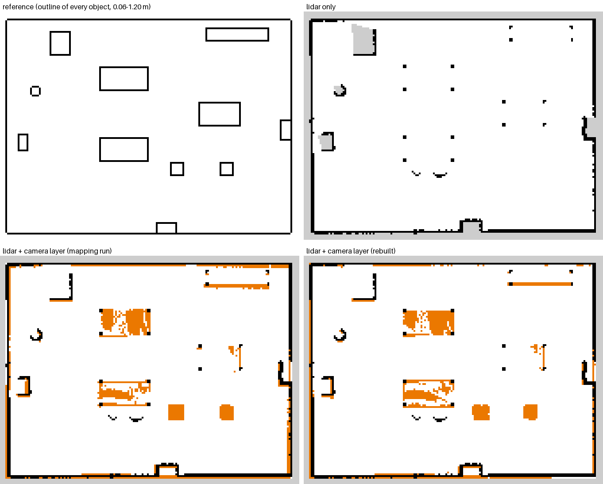

# KELO Autonomous Navigation

**English** | [Türkçe](README.tr.md)

ROS 2 Jazzy navigation stack for the KELO Robile omnidirectional platform, packaged as a Docker image
for the NVIDIA Jetson Orin Nano.

| Component | Technology |
|---|---|
| Mapping | slam_toolbox |
| Localization | AMCL, Marvelmind indoor positioning |
| Navigation | Nav2 (MPPI; paths are followed forward, the platform itself is omnidirectional) |
| Sensors | Hokuyo URG-04LX (2D LiDAR), Intel RealSense D435 (depth), Marvelmind hedgehog |
| Safety | Two collision monitors (LiDAR + depth), velocity gate, watchdog, position divergence monitor |

The stack does not modify the robot's low-level driver. The interface to the robot is limited to
`/cmd_vel`, `/odom` and the `odom → base_link` transform.

> **Safety notice.** The safety functions in this project are implemented in software and are not
> certified. The URG-04LX and the D435 are not safety-rated sensors. Operation in areas shared with
> people requires a certified safety laser scanner. The hardware emergency stop operates independently
> of this software and must be within reach during every test.

## Contents

1. [Getting started](#getting-started)
2. [Project layout](#project-layout)
3. [Architecture](#architecture)
4. [Velocity command path](#velocity-command-path)
5. [Quick start](#quick-start)
6. [Configuration](#configuration)
7. [Installation on the Jetson](#installation-on-the-jetson)
8. [Commissioning procedure](#commissioning-procedure)
9. [Mapping with a sensor cart](#mapping-with-a-sensor-cart)
10. [Recording and replay](#recording-and-replay)
11. [Safety system](#safety-system)
12. [Simulator](#simulator)
13. [Testing](#testing)
14. [Operations and maintenance](#operations-and-maintenance)
15. [Open items](#open-items)
16. [Known limitations](#known-limitations)

## Getting started

The simulator runs on any 64-bit Linux computer (x86-64 or ARM64, e.g. the Jetson). No robot or
sensor is required.

1. Install Docker Engine and the Docker Compose plugin
   ([instructions](https://docs.docker.com/engine/install/)), then allow your user to run Docker:
   ```bash
   sudo usermod -aG docker $USER      # log out and back in afterwards
   ```
2. Download the project:
   ```bash
   git clone https://github.com/beratbalcibaran/kelo_docker.git
   cd kelo_docker
   ```
3. Build the image and start the control panel (the first build takes 15–30 min and about 5 GB):
   ```bash
   docker compose --profile gui up --build
   ```
4. When the log shows `KELO interface ready`, open
   `http://localhost:6080/vnc.html?autoconnect=true&resize=scale` and enter the VNC password printed
   in the log.
5. In the panel, leave the source on `sim` and follow these steps:

   **Build a map**
   1. **Start Mapping**: the simulator and RViz start, the map begins to grow.
   2. Click the panel window once, then drive with WASD or the arrow keys around the whole room
      until the walls in RViz are closed.
   3. **Save Map**: give a name (e.g. `room`). The log shows `Saved: ...` and
      `current.yaml -> ...`.
   4. **Stop Mapping**.

   **Navigate on the map**
   1. **Start Navigation**: the robot starts again at the point where mapping began. That point is
      `x=0, y=0` on the map.
   2. **Set Initial Pose**: enter X `0`, Y `0`, Yaw `0`. The robot may turn in place; wait until
      the log shows `LOCALIZED`.
   3. **Send Goal**: enter a free point on the map, e.g. X `0`, Y `2`, Yaw `0` (2 m to the left of the
      start). The log shows `Goal reached.` when the robot arrives. A goal can also be set in RViz
      with **2D Goal Pose**.
   4. **Stop Navigation** when done.

   **Localize** (without a position) uses the Marvelmind position when an alignment file exists. Without
   it, it first tries the last saved pose and otherwise searches the whole map while turning in place;
   the result is accepted only when the LiDAR scan fits the walls of the map there. In a symmetric room
   it can still need **Set Initial Pose**.
6. Stop with `Ctrl+C`, or `docker compose --profile gui down`.

The repository ships without maps: create one with **Start Mapping** / **Save Map** first. Maps
(`data/maps`), recordings (`data/bags`) and Marvelmind samples stay local and are not part of the repository.

## Project layout

```
kelo_docker/
├── README.md, README.tr.md     this documentation (English, Turkish)
├── Dockerfile                  builds the image: ROS 2 Jazzy, Nav2, drivers, this package
├── docker-compose.yml          start profiles (gui, sim, sim-nav, replay, production, mapping, ...)
├── docker/                     scripts that run inside the container
├── scripts/                    tests and Jetson installation, run on the host computer
├── systemd/kelo.service        starts the robot software automatically at boot (Jetson)
├── data/                       maps and recordings, mounted into the container as /data
└── src/kelo_bringup/           the ROS 2 package (all of the robot software)
```

| Path | Purpose |
|---|---|
| `docker/entrypoint.sh` | Prepares the ROS environment when a container starts |
| `docker/start-gui.sh` | Starts the browser control panel (noVNC + panel + RViz) |
| `docker/run-stack.sh` | Starts the software without the panel (used by the headless profiles and the service) |
| `docker/cyclonedds.xml` | Network settings for ROS 2 communication |
| `docker/detector/Dockerfile` | Jetson only: object detector on the GPU (TensorRT, YOLOX-s), the `detector` profile |
| `src/kelo_bt_nodes/` | Nav2 behaviour tree node `IsPersonBlocking` (C++): wait for a person on the path |
| `scripts/test_all.sh` | Builds the image and runs all tests |
| `scripts/sim_e2e_test.sh` | End-to-end tests in the simulator |
| `scripts/replay_regression.sh` | Rebuilds a map from a recording and compares it with a reference |
| `scripts/camera_layer_eval.sh` | Two-layer map evaluation in the simulator (maps, coverage, navigation goals) |
| `docs/task1/` | Two-layer map results from the simulator (tables and side-by-side maps) |
| `scripts/install_jetson.sh` | Installs the project on the Jetson (`/opt/kelo`, udev, systemd) |
| `data/maps/` | Saved maps (local, not in the repository); `current.yaml` points to the map used for navigation |
| `data/mm_samples_*.csv` | Marvelmind alignment samples recorded during mapping (local) |
| `data/bags/` | Sensor recordings made during mapping (not in the repository) |
| `data/hardware.yaml` | Optional local override of `config/hardware.yaml` (not in the repository) |

Inside `src/kelo_bringup/`:

| Path | Purpose |
|---|---|
| `config/hardware.yaml` | **Start here.** Which sensors are installed, serial ports, sensor positions, robot size, odometry correction |
| `config/safety.yaml` | Speed limits, stop and slowdown zones, depth camera filter |
| `config/nav2_params.yaml` | Localization (AMCL), path planning and following (Nav2), costmaps |
| `config/slam_toolbox.yaml` | Map building settings |
| `config/sim_world.yaml` | Simulator room, obstacles and odometry error |
| `config/sim_world_tables.yaml` | Simulator room with tables, a shelf and low objects (two-layer map evaluation) |
| `launch/bringup.launch.py` | Single entry point that starts everything |
| `gui.py` | The control panel (buttons, WASD driving) |
| `behavior_trees/navigate_wait_then_detour.xml` | Nav2 behaviour: stop and wait for an obstacle on the path, then drive around it |
| `urdf/kelo.urdf.xacro` | Robot model: body and sensor positions |
| `rviz/kelo.rviz` | RViz view settings |
| `udev/99-kelo-serial.rules` | Fixed device names for the USB sensors |
| `test/` | Unit tests (pytest) and reference data |

Programs in `src/kelo_bringup/kelo_bringup/`:

| File | Purpose |
|---|---|
| `stack.py`, `common.py` | Decide which programs start, depending on source, mode and installed sensors |
| `cmd_vel_gate.py` | The only program that sends speed commands to the robot; limits speed, stops on timeout |
| `cloud_filter.py` | Turns the depth image into an obstacle point cloud |
| `camera_mapper.py`, `camera_grid.py` | Two-layer map: accumulates camera obstacles during mapping into a second map layer |
| `camera_layer_rebuild.py` | Rebuilds the camera layer of a finished map from its mapping bag (poses agree with the final map) |
| `odom_filter.py` | Corrects the robot's wheel odometry |
| `status_node.py` | Reports the overall state and holds the localization state |
| `localize.py` | Finds the robot's position on the map (GUI: Localize) |
| `robot_check.py` | First-connection check of the robot interface (topics, types, rates, TF ownership, clock offset; does not move the robot) |
| `loc_monitor.py`, `scan_match.py` | Checks the localization against the map (scan fit), reports `LOST`, saves and restores the last pose |
| `send_goal.py` | Sends a navigation goal (GUI: Send Goal) |
| `waypoint_tool.py` | Stores named positions and drives between them |
| `save_map.py` | Saves the current map (GUI: Save Map) |
| `marvelmind_bridge.py`, `mm_monitor.py`, `mm_recorder.py`, `mm_calibrate.py` | Marvelmind: position conversion, plausibility check, sample recording, map alignment |
| `odom_test.py` | Measures odometry error on the real robot |
| `map_compare.py` | Compares two maps |
| `map_side_view.py` | RViz: camera layer beside the LiDAR map (display only) |
| `camera_view.py` | KELO Camera window (colour and depth camera views at full resolution) and KELO Surround window (surround view / mapping coverage); double click = drive there |
| `parking_view.py` | Front camera view: guide lines that follow the commanded motion, obstacles marked, Nav2 plan on the floor, named objects, colour and depth (display only) |
| `surround_view.py` | Surround view like a Tesla's screen: the robot in 3D with walls, objects, park assist distances and the plan (display only) |
| `objects.py`, `detector.py` | Objects around the robot from LiDAR + camera, named by YOLOX on the colour image, tracked; obstacle memory |
| `detector_service.py`, `trt_detector.py` | Detector as a TCP service; TensorRT backend for the Jetson GPU (kelo-detector container) |
| `social.py` | People-aware navigation: personal space and predicted walking path in the costmaps, speed limit near people, person on the path |
| `coverage_view.py` | Mapping coverage: camera coverage, areas seen only from far, frontiers, next target (display only) |
| `video_recorder.py` | mp4 recording of the driver views and dashcam clip (`/data/videos`) |
| `web_view.py` | Driver views, status, tap-to-drive and joystick in a phone browser (port 8080) |
| `scene.py`, `drive_inputs.py` | Shared geometry and inputs of the driver views (motion prediction, plan strip, park assist sectors, clusters, tracker) |
| `layer_eval.py` | Two-layer map evaluation in the simulator (reference map, per-object coverage, phantom cells, side-by-side map figure) |
| `wait_for_tf.py` | Waits until required coordinate frames are available at start-up |
| `logic.py` | Shared calculations (tested by the unit tests) |
| `sim_robot.py`, `sim/world.py` | The simulator: robot, sensors and collisions |
| `e2e.py` | End-to-end test scenarios |
| `sim_person.py` | Simulator test helper: a person steps onto the planned path in front of the robot (GUI: Person on path) |

### Key terms

| Term | Meaning |
|---|---|
| ROS 2 | The robot software framework; programs (nodes) exchange messages on named topics such as `/scan` |
| Docker image / container | A packaged environment with all dependencies; nothing else needs to be installed on the computer |
| Profile | A start configuration in `docker-compose.yml`, selected with `--profile` |
| Odometry | Position estimate from the wheels (or from the LiDAR) |
| SLAM / mapping | Building a map while driving |
| Localization (AMCL) | Finding the robot's position on an existing map |
| Costmap | Map of areas to avoid, used for path planning |
| Collision monitor | Stops or slows the robot when an obstacle enters a zone around it |
| TF / frame | Coordinate systems (`map`, `odom`, `base_link`, sensors) and the transforms between them |

## Architecture

The real robot, the simulator and bag replay share a single launch file
(`launch/bringup.launch.py` → `kelo_bringup/stack.py`) with identical nodes and parameters. Only the
source layer differs. The simulator publishes every sensor on the same topics, frames and message types
as the hardware.

```
                 ┌─ hardware: urg_node, realsense (depth only), marvelmind_ros2
 source layer  ──┼─ sim     : sim_robot (robot and all sensors, faulty odometry model)
                 └─ replay  : ros2 bag play --clock (use_sim_time)
                        │  /scan  /odom  depth image + camera_info  /hedgehog_pos_ang
                        ▼
 odometry       odom_source:=robot → odom_filter (speed-dependent correction) | odom_source:=lidar → rf2o
 common         robot_state_publisher, cloud_filter (depth → obstacle cloud), marvelmind_bridge,
                cmd_vel_gate, collision_monitor_teleop, status_node
 mode           mapping: slam_toolbox (+ bag recording) | navigation: AMCL + Nav2 + mm_monitor | sensors

 Nav2 → velocity_smoother → collision_monitor ──→ /cmd_vel_safe ─────┐
 teleop/GUI → /cmd_vel_teleop → collision_monitor_teleop ────────────┴→ cmd_vel_gate → /cmd_vel → robot

 TF: map → odom → base_link → {laser, camera_link → camera_depth_optical_frame, hedgehog_link}
```

### Odometry ownership

The `odom → base_link` transform always has exactly one publisher.

| Configuration | TF publisher | Odometry topic used by Nav2 |
|---|---|---|
| `odom_source:=robot`, `odom_mode: corrected` (default) | `odom_filter` (driver TF must be disabled) | `/odom_corrected` |
| `odom_source:=robot`, `odom_mode: driver` | robot driver (reconstructed from `/odom` in replay) | `/odom` |
| `odom_source:=lidar` | rf2o | `/odom_rf2o` |

All Nav2 nodes that consume odometry, including the MPPI controller, subscribe to the topic of the
active TF publisher.

### Sensor configuration

Installed sensors are declared in `hardware.yaml → sensors`. Disabling a sensor removes its driver,
costmap layer and collision-monitor source for every source type.

## Velocity command path

The stack publishes body velocities; the robot's driver converts them into wheel commands.

- **Topic:** `/cmd_vel`, type `Twist` or `TwistStamped` (`hardware.yaml → robot.cmd_vel_type`).
- **Fields:** `linear.x` forward (m/s), `linear.y` lateral (m/s), `angular.z` yaw rate (rad/s).
- **Single publisher:** `cmd_vel_gate` is the only node that publishes `/cmd_vel`. Nav2, keyboard
  teleoperation and the localization spin all pass through a collision monitor and then the gate.
- **Gate behaviour:** limits speed to 0.30 m/s and 0.80 rad/s; publishes zero velocity when no command
  is received for 0.5 s, when a safety stop is active, and on shutdown (SIGINT and SIGTERM).
- **Exception:** `odom_test calibrate-rotate` writes directly to the driver for calibration only and
  refuses to start while the gate is running.

## Quick start

### Graphical interface

The control panel runs in the browser through noVNC.

```bash
docker compose --profile gui up --build            # workstation, default source: sim
docker compose --profile gui-hardware up --build   # Jetson with hardware, default source: hardware
```

When the log shows `KELO interface ready` together with a VNC password, open
`http://localhost:6080/vnc.html?autoconnect=true&resize=scale`. Set `KELO_VNC_PASSWORD` to use a fixed
password; otherwise a random password is generated at each start.

The panel selects the source (sim, hardware, replay) and the odometry source (robot, lidar) and provides
Start Mapping, Save Map, Stop Mapping, Start Navigation, Set Initial Pose, Localize, Send Goal and Stop
Navigation. WASD and the arrow keys drive the robot through `collision_monitor_teleop` and
`cmd_vel_gate`.

RViz runs as a separate, supervised process. If it terminates, the panel restarts it without affecting
the robot, sensor or safety nodes.

**RViz view and camera window.** RViz shows two maps side by side: the LiDAR map with the robot, the
costmaps and the plan, and to its right the camera layer (`/map_camera`, with the robot as an arrow).
Below RViz, the **KELO Camera** window (`camera_view`) shows the front camera view at full
resolution: colour image on the left, depth image on the right. Below the control panel, the
**KELO Surround** window shows the surround view, or with its **Coverage** button the mapping
coverage. The objects and the driver views (`objects`, `parking_view`, `surround_view`,
`coverage_view` in mapping) run in the stack and draw only while someone watches; the panel starts
the windows `map_side_view` and `camera_view` together with RViz. The virtual screen is
2240 × 1260 (16:9, `SCREEN_RES`): RViz at the top left, the camera window below it, the control panel
at the top right and the surround window below it. RViz also shows the objects (`Objects`, boxes and
names).

```
+------------------------------+---------------+
| RViz: LiDAR map | camera map | control panel |
+------------------------------+---------------+
| KELO Camera: colour | depth  | KELO Surround |
+------------------------------+---------------+
```

**Camera view** (`parking_view`, like a car's parking camera). Guide lines on the floor at the robot
width plus 0.10 m on each side, from the front edge to 2.5 m ahead, with bars every 0.5 m (red up to
0.5 m, yellow up to 1.0 m, green beyond). The lines follow the commanded velocity (`/cmd_vel`) like a
car's lines follow the steering wheel: they show where the front corners go when the robot keeps its
current motion (forwards, sideways, turning; at most a 2 rad turn); standing still, turning on the
spot or reversing they point straight ahead. Pixels whose 3D point (from the depth image) lies
0.06–1.20 m above the floor are marked: red inside the area the robot sweeps along the guide lines,
amber up to 0.4 m beside it. While Nav2 drives to a goal, the plan is drawn on the floor as a blue
strip with arrows flowing towards the goal; it passes behind obstacles (pixels with an obstacle in
front of the floor are not painted), and a pin with the remaining distance marks the goal when it is
in view. On the colour image, the objects named by the detector get corner brackets with name and
distance from the robot (`PERSON 1.5 m`); people the LiDAR still tracks after the detector lost them
keep their bracket (their 3D box projected into the image). The bottom line
shows the distance from the front edge to the nearest obstacle in the guide lines (`CLEAR` otherwise),
also published on `/parking_view/nearest`. Both images are also available as `/parking_view/color_image`
and `/parking_view/image` (RViz Image displays `ParkingViewColor`, `ParkingViewDepth`, off by default).
The view is for the operator only; stopping and avoiding use the costmaps and the collision monitor.
The camera sees the floor from about 0.9 m ahead of the front edge (10° tilt), so the first guide bars
are below the image. The colour stream (`hardware.yaml → camera.color`, `color_profile`) is used
only for this view; set `color: false` if the Jetson needs the USB bandwidth. `camera.color_offset_y`
is the position of the colour imager in `camera_link` (D435: 15 mm beside the depth origin); check its
sign against the camera's depth-to-colour extrinsics on the robot (`/camera/camera/extrinsics/depth_to_color`).

**Surround view** (`surround_view`, like a Tesla's driving screen; `view:=top` looks straight down).
The robot seen from behind and above in 3D: the map walls as blocks, a floor grid fixed to the map, the
LiDAR points (red / orange when closer than 0.3 / 0.6 m), the camera obstacle points flattened onto
the floor, people as standing figures and other objects as orange boxes with their distance and an
arrow when they move, the guide lines of the commanded velocity and, while navigating, the plan as a
blue road with flowing arrows and a goal pin. **Park assist**: around the footprint, in 24 directions,
the nearest obstacle within 1.2 m as an arc at its place (red < 0.3 m, orange < 0.6 m, yellow < 1.0 m,
green beyond) and the nearest distance in cm. The LiDAR sees only ±92° to the front: behind it the map
walls (within 0.8 m) are used and the arc is drawn dashed, as there is no live sensor there. The top
bar shows the speed, the distance to the goal and the nearest obstacle. Rendered with OpenCV
(960 × 720, 10 Hz), no GPU needed.

**Objects** (`objects`). The LiDAR scan and the camera obstacle cloud, without the points on the map
walls (grown by 0.25 m), grouped on a 0.1 m grid; groups up to 2 m become objects, unnamed groups
touching a map wall are left out (wall ends). YOLOX-tiny (COCO, official ONNX export, downloaded and
checked by the Dockerfile into `/opt/kelo/models`) runs on the colour image with OpenCV DNN on the CPU
(`hardware.yaml → perception`, 3 Hz, ~50 ms per image on this VM); the camera points inside a detection
box give its position and the nearest group takes the name. A tracker in the odom frame smooths the
objects and keeps a name for 5 s after the camera lost it. Outputs: `/kelo/objects`
(`vision_msgs/Detection3DArray`, odom frame), `/kelo/detections` (`vision_msgs/Detection2DArray`,
colour pixels) and `/kelo/objects/markers` (RViz). In the simulator the people come from `/sim/people`
(the simple colour rendering has nothing YOLOX would recognise). The people are used by the people-aware
navigation (below); the other names are display only. Without the model file or with
`perception.detector: false` the objects stay unnamed. When the detector service answers
(`perception.service`, on the Jetson the `detector` profile: YOLOX-s with TensorRT on the GPU, see
[Installation on the Jetson](#installation-on-the-jetson)), the detection runs there; otherwise here on
the CPU, and the service is tried again every 10 s.

**People-aware navigation** (`social`, navigation mode, `hardware.yaml → navigation.people_aware`).
A person is treated differently from a box:

| | Person | Box / other obstacle |
|---|---|---|
| Distance kept | personal space: high cost (not lethal) within 0.55 m of the person, falling cost out to 1.2 m: the plan passes wide where there is room, close by in a narrow passage; lethal is only what the LiDAR and camera see | footprint + 0.70 m inflation |
| Speed | 40 % within 1.0 m of the footprint, back to 100 % at 2.0 m (`/speed_limit`); not on top of the collision monitor slowdown | unchanged (collision monitor slowdown zone) |
| On the path ahead | the robot stops and **waits** for the person to step aside (checks every 0.5 s, up to 10 s), then drives on straight; only a person who stays is passed, with the personal space | waits 5 s, then **drives around** it |
| Walking person | where they walk in the next 3 s is in the costmaps (lethal for 1.5 s ahead): the robot does not plan into their way and gives way when they cross | – |

The social node takes the people of `/kelo/objects` (with their velocity) and publishes
`/kelo/people_map` (same geometry as `/map`; read by the `people_layer` StaticLayer of the global
costmap, so the planner passes people wide; the local costmap has the person from the LiDAR and the
camera: the graded costs there slowed the controller to a crawl next to a person),
`/speed_limit`, `/kelo/person_blocking` (a person or their walking path within 0.8 m of the next 2.5 m
of the plan) and `/kelo/people/markers` (RViz: rings and predicted paths). The behaviour tree reads
`/kelo/person_blocking` with the `IsPersonBlocking` node (`src/kelo_bt_nodes`). The people layers only
add cost: a person the detector misses is still an obstacle in the LiDAR and camera layers, handled
like a box.

**Obstacle memory.** The objects node keeps the LiDAR and camera obstacle points in the odom frame
after the sensors stop seeing them (`/kelo/obstacle_memory`, 5 cm cells, fields x y z age). A cell is
forgotten when a sensor sees through it again (a LiDAR beam that ends further away; the camera for
low objects, which the LiDAR passes over), after 30 s, or further than 6 m. The surround view draws
them as grey dots fading over 30 s and its park assist uses them (dashed) behind the robot, where the
LiDAR does not look. Display only; the costmaps keep their own obstacles.

**Click to drive.** In navigation mode, a double click on the floor in the surround view or in the
colour or depth image sends the robot there (Nav2 goal; it faces away from the robot, at most 15 m
away); a right click cancels the goal. The view that drew the image turns the pixel into a floor
point (`/kelo/view_click`), a short note in the view says what happened.

**Mapping coverage** (`coverage_view`, mapping mode, KELO Surround → Coverage). Top view of the map
being built: green = free floor seen by the LiDAR and the camera, amber = LiDAR only (low objects may
be missing from the camera layer), grey-blue = seen only from further than 3 m, orange = frontiers to
unexplored space, the nearest one marked as the next target with its distance, and the robot's track.
The top lines give the mapped area and the shares. Map until there are no frontiers and little amber.

**Video** (`video_recorder`). Record / Stop Recording in the panel (or the web view) writes the
surround view and the colour camera side by side to `/data/videos/kelo_<date>_<time>.mp4` (10 fps,
H.264 when available, stops by itself after 30 min or with less than 1 GB free). With
`recording.dashcam_s: 60` the last minute is kept in memory and **Save Clip** writes it to a file,
like a dashcam after an incident (costs CPU: the views are rendered all the time).

**Web view** (`web_view`), for a phone or tablet: `http://<robot>:8080` (GUI container:
`http://localhost:8080`), user `kelo`, password `KELO_WEB_PASSWORD` (if not set, a random one is
printed in the log). Live views (Surround, Camera, Depth, Coverage; rendered only while watched),
speed, goal distance, person and recording state; double tap on the floor = drive there, Cancel goal,
Record, Save clip, and a hold-to-drive joystick (`web.allow_drive`): it drives through the teleop
collision monitor and the gate like the keyboard and stops when the finger leaves the pad or the
connection drops (0.3 s). Plain HTTP: only on the robot's own network.

**Person on path (sim)** (checked by default, simulator only): with Start Navigation, `sim_person`
starts too. For every goal, once the robot drives, a person stands on the planned path about 1.8 m ahead
and is removed when the robot has passed, when the goal ends, or after 60 s. Other modes:
`ros2 run kelo_bringup sim_person --ros-args -p mode:=cross` (walks once across the path) or
`-p mode:=block` (a wall across the room: the robot has to wait).

### Headless profiles

| Profile | Function |
|---|---|
| `sim` | Simulator with mapping and bag recording |
| `sim-nav` | Simulator with AMCL and Nav2 on the saved map |
| `replay` | Mapping from a recorded bag (`KELO_BAG`) |
| `production` | Robot navigation (used by systemd); `KELO_MODE=sensors` keeps the robot stationary |
| `mapping` | Robot mapping; `KELO_ODOM_SOURCE=lidar` for sensor-cart mapping |

Environment variables read by `docker/run-stack.sh`:

| Variable | Values |
|---|---|
| `KELO_SOURCE` | `hardware`, `sim`, `replay` |
| `KELO_MODE` | `navigation`, `mapping`, `sensors` |
| `KELO_ODOM_SOURCE` | `robot`, `lidar` |
| `KELO_MAP` | map YAML path |
| `KELO_BAG` | bag directory, e.g. `/data/bags/<bag>` |
| `KELO_INITIAL_POSE` | `"x y yaw_deg"` (default `0 0 0`) |
| `KELO_EXTRA_ARGS` | additional launch arguments |

## Configuration

| File | Contents |
|---|---|
| `config/hardware.yaml` | Sensors, topics, frames, mounting positions, odometry correction tables |
| `config/safety.yaml` | Velocity gate, teleop collision monitor, depth filter, Marvelmind monitor, status |
| `config/nav2_params.yaml` | AMCL, Nav2, costmaps, Nav2 collision monitor |
| `config/slam_toolbox.yaml` | SLAM parameters |
| `config/sim_world.yaml` | Simulator world and odometry error model |
| `config/sim_world_tables.yaml` | Simulator world for the two-layer map evaluation |

Paths are relative to `src/kelo_bringup/`.

## Installation on the Jetson

```bash
sudo ./scripts/install_jetson.sh --enable-service
```

The script installs the project to `/opt/kelo`, builds the image, installs the udev rules and registers
the `kelo` systemd service.

Requirements:

- JetPack with Docker and the Docker Compose plugin.
- Wired network connection to the robot computer.
- `ROS_DOMAIN_ID` in `/etc/kelo/kelo.env` matching the robot computer.

**Object detection on the GPU (optional).** The `detector` profile runs YOLOX-s with TensorRT (FP16) in
its own container (`docker/detector/Dockerfile`, NVIDIA L4T base image, no ROS); the objects node
sends it the colour images over `127.0.0.1:5810` and falls back to YOLOX-tiny on the CPU while it
does not answer:

```bash
cat /etc/nv_tegra_release        # R36.4 -> default base image; others: see docker/detector/Dockerfile
docker compose --profile detector build      # --build-arg L4T_IMAGE=... for another JetPack
docker compose --profile detector up -d      # first start builds the engine (a few minutes, /data/models)
docker logs kelo-detector                     # "[detector] tensorrt ... listening on 127.0.0.1:5810"
```

The objects node logs `object detection: using the detector service (tensorrt)`. Not yet tested on the
Jetson (no GPU in the development VM): the protocol and the fallback are tested here, the TensorRT
part only on the robot.

DDS middleware is Cyclone DDS (`docker/cyclonedds.xml`). The hardware profiles (`production`, `mapping`,
`gui-hardware`) bind DDS to `KELO_DDS_IFACE` (default `enP8p1s0`); if that interface is down they log a
warning and fall back to automatic selection. The Jetson uses the static IP `192.168.1.10/24` on the robot
Ethernet and serves time to the robot with chrony (`allow 192.168.1.0/24`, `local stratum 10`). Serial device paths are configured in
`hardware.yaml → serial` (see `ls /dev/serial/by-id/`).

## Commissioning procedure

### 1. Hardware check (robot stationary)

```bash
KELO_MODE=sensors docker compose --profile production up
```

Verify `ros2 topic hz /scan`, the TF tree in RViz and the periodic status line
(`docker logs kelo-production | grep STATUS`).

### 2. Odometry characterisation

The robot moves during this step. Use an open area, low speed and keep the emergency stop at hand.

```bash
docker compose run --rm production ros2 run kelo_bringup odom_test straight --speed 0.1 --distance 2.0
docker compose run --rm production ros2 run kelo_bringup odom_test rotate --rate 0.6 --turns 1
docker compose run --rm production ros2 run kelo_bringup odom_test summary
```

Measured KELO odometry under-reports yaw significantly and in a speed-dependent way: one physical
revolution is reported as approximately 68° at 0.6 rad/s (k ≈ 5.3) and 42° at 1.5 rad/s (k ≈ 8.6).
Linear error ranges from −0.6 % at 0.06 m/s to −1.8 % at 0.15 m/s.

Enter the results in `hardware.yaml → odom_correction` (`yaw_k: wz/k`, `linear_error: v/e`). Values are
interpolated linearly between points and clamped to the end values outside the table. `odom_filter`
applies the inverse correction at every step.

**Calibration above the gate limit.** To measure k above 0.80 rad/s, stop the stack and run:

```bash
docker compose down
docker compose run --rm production ros2 run kelo_bringup odom_test calibrate-rotate --rate 1.5 --turns 3
```

This mode bypasses `cmd_vel_gate`, the speed limit and the collision monitors. It is restricted to
in-place rotation (≤ 1.6 rad/s, ≤ 3 turns), requires typing `CALIBRATE` to confirm, publishes zero
velocity on every exit and refuses to run while the gate is active. Use at least three turns; the
acceleration ramp causes a slight underestimate of k. Not for production use.

### 3. Mapping

```bash
docker compose --profile mapping up
docker compose exec mapping ros2 run teleop_twist_keyboard teleop_twist_keyboard --ros-args -r cmd_vel:=/cmd_vel_teleop
docker compose exec mapping ros2 run kelo_bringup save_map warehouse
```

Drive slowly and close the loop. `save_map` writes `/data/maps/warehouse_<date>.*` (PGM, YAML and the
slam_toolbox pose graph) and updates `current.yaml`. Edit the PGM to remove temporary objects and to
mark keep-out areas.

During mapping, sensor data is recorded to `/data/bags/map_<source>_<date>` (scan, odometry, depth
image and camera info, Marvelmind, TF; MCAP with zstd, about 1 MB/s). The point cloud is regenerated
from the depth image during replay and is not recorded. Disable recording with
`KELO_EXTRA_ARGS=record:=false`. When Marvelmind is enabled, alignment samples are written to
`/data/mm_samples_<date>.csv`.

#### Two-layer map (LiDAR + camera)

The LiDAR sees one plane about 20 cm above the floor, so tables appear only as their legs, and shelves,
overhangs and objects below the plane are missing from the LiDAR map. With the camera layer, what the
D435 sees during mapping is saved as a second map layer and used by the global planner.

- **Pose stays LiDAR-only.** slam_toolbox is unchanged. No camera points go into scan matching.
- **Accumulation.** `camera_mapper` (mapping mode only) takes the height-filtered obstacle points from
  `cloud_filter` (`/camera/points_filtered`) and the clearing rays (`/camera/points_map_clearing`),
  transforms them into `map` with the slam_toolbox pose at the image time, and accumulates them in
  log-odds voxel columns: 0.10 m height bands between `cloud_filter` `min_height` and `max_height`
  (0.06–1.20 m) on the same grid as the LiDAR map (resolution, origin and size follow `/map`).
  A cell is an obstacle when any band in it is occupied. This keeps a table top even though the floor
  under it is seen free. Clearing rays lower the bands they cross, but each voxel remembers the highest
  point that hit it, and a ray that crosses it above that point does not lower it: rays that graze the
  top of a low object on their way to the floor behind it would otherwise erase it (in the simulator a
  12 cm box was mostly free in the map, and the robot drove into it). A person walking by is still
  erased once the area is seen free again, by the rays that pass through the person's height. Clearing rays are the valid depth pixels pulled back to 4 m
  (`map_clearing_range`), so free space beyond the 2.5 m marking range also counts. A single noisy hit
  does not mark a cell (about two consistent hits are needed). Processing runs at 5 frames/s. The layer is
  published live as `/map_camera` for RViz.
- **Save.** `save_map <name>` also writes `<name>_<date>_camera.yaml/.pgm`, cropped or padded to exactly
  the size and origin of the LiDAR map.
- **Navigation.** When `<map>_camera.yaml` exists next to the map (symlinks such as `current.yaml` are
  resolved), a second `map_server` (`map_server_camera`) publishes it on `/map_camera`. The global
  costmap loads it as `camera_static_layer`, a second `StaticLayer` directly after `static_layer`.
  The layer can only add obstacles: its free cells never clear a LiDAR wall, and its unknown cells
  leave the LiDAR map unchanged. Nav2 Jazzy's `StaticLayer` reads `use_maximum` (and
  `trinary_costmap`) from the costmap, not from the layer, so `use_maximum: true` is set on both
  costmaps; a per-layer setting is ignored and the layer overwrites the LiDAR map (fixed on 22.10.:
  before, LiDAR walls the camera map did not have were lost from the global costmap). Camera maps
  are saved with `free_thresh: 0.196` so that their unknown pixels (205) load as unknown; camera maps
  saved before 22.10. have `0.25` (unknown loads as free): change that line in their `_camera.yaml`. The local costmap loads the same layer first in its
  plugin list, so the controller keeps mapped low objects that are in the camera blind zone or beside
  and behind the robot, where the camera does not look (without it the robot hit a 12 cm box while
  turning next to it in the simulator). This layer follows the AMCL pose: `localize` turns it off
  during its turns in place, while the pose is not known yet, and back on afterwards; the collision
  monitor and the live sensor layers stay active. AMCL uses the LiDAR map only, as before.
- **Live camera obstacles.** The live `camera_layer` of both costmaps is a `VoxelLayer` (0.08 m voxels up
  to 1.28 m). With a 2D `ObstacleLayer`, a clearing ray that passes over a low object to the floor behind
  it erased the object as soon as it entered the camera blind zone, and the robot drove into it.
- **Switch.** `hardware.yaml → mapping.camera_layer` (default `true`). With `camera_layer: false`, with
  `sensors.camera: false`, or with no `_camera.yaml` file, the stack starts exactly as without the
  feature (no `camera_mapper`, no second map server, no extra costmap layer).
- **Editing.** If you edit the LiDAR PGM to remove temporary objects, edit `<name>_camera.pgm` the same
  way. Deleting the `_camera.*` files turns the layer off for that map.

- **Rebuild after mapping (recommended).** During mapping, cells are placed with the slam_toolbox pose
  of the moment they are seen. A later loop closure corrects the LiDAR map but not the camera cells
  already accumulated. After `save_map`, rebuild the layer from the mapping bag:

  ```bash
  docker compose exec mapping ros2 run kelo_bringup camera_layer_rebuild /data/bags/map_hardware_<date>
  ```

  The bag is replayed on the finished LiDAR map (`current.yaml`, or a map given as second argument) and
  `<name>_camera.yaml/.pgm` is written again with poses that agree with the final map. The robot is
  localized by slam_toolbox on the saved pose graph (`<name>.posegraph`, same scan matcher as the
  mapping run). Without a pose graph, AMCL is used (`--localizer amcl` forces it; in the simulator it is
  less precise than slam_toolbox and gives a worse layer, see the results below).
  The layer from the mapping run is kept as `<name>_camera_live.yaml/.pgm`. The start pose is read from
  the TF in the bag. The replay runs on its own ROS domain (`--domain`, default 99, localhost only), so
  it can run next to a live stack; `--rate` speeds up the playback. The same replay is available as
  `mode:=camera_layer source:=replay`.

- **Evaluation.** `scripts/camera_layer_eval.sh` runs the whole comparison in the simulator, in
  `config/sim_world_tables.yaml` (8 × 6 m room with two desks, a table, a shelf on legs, two boxes of
  0.12 and 0.15 m and a person walking by during mapping). One mapping drive is recorded and the same
  bag is mapped twice, with `camera_layer: false` and `true`; the camera layer is then rebuilt from the
  bag. Each map is compared with a reference drawn from the world (`map_compare`, `layer_eval`), and
  the 10 navigation goals of the world are driven on each map. `--bag <dir>` reuses a recorded bag,
  `--skip-nav` stops after the maps. Results are written to `data/eval/task1_<date>/results.md`.

##### Results (simulator)

Full tables: [docs/task1/sim_results.md](docs/task1/sim_results.md). Black: LiDAR map, orange: cells
added by the camera layer.



| map | precision | recall | F1 | phantom cells |
|---|---|---|---|---|
| LiDAR only | 0.982 | 0.681 | 0.804 | 16 |
| LiDAR + camera layer (mapping run) | 0.841 | 0.909 | 0.874 | 48 |
| LiDAR + camera layer (rebuilt) | 0.862 | 0.904 | **0.882** | 17 |

| object (share of outline in the map) | LiDAR only | camera layer (mapping run) | camera layer (rebuilt) |
|---|---|---|---|
| desks (tops at 0.60 m) | 0.25 | 0.96–1.00 | 0.95–0.99 |
| table_c | 0.26 | 0.53 | 0.51 |
| shelf (lowest board 0.30 m) | 0.21 | 0.61 | 0.57 |
| low boxes (0.12 m, 0.15 m) | 0.00 | 1.00 | 1.00 |

Navigation: the 10 goals of the world on each map, two runs (reached goals and collisions per run):

| map | reached | collisions | collision monitor stops | reroutes |
|---|---|---|---|---|
| LiDAR only | 5/10, 5/10 | 33, 42 | 19, 0 | 7, 1 |
| LiDAR + camera layer (mapping run) | 6/10, 6/10 | **0, 0** | 5, 2 | 1, 0 |
| LiDAR + camera layer (rebuilt) | 8/10, 6/10 | **0, 3** | 21, 1 | 0, 0 |
| ablation, camera layer in the global costmap only (mapping run, rebuilt; one run) | 6/10, 6/10 | 12, 14 | 3, 3 | 0, 0 |

How to read the numbers:

- The LiDAR map has almost no false cells (precision 0.98) but misses most of the tables, the shelf
  and the low boxes (recall 0.68). The camera layer adds them (recall 0.90–0.91).
- Precision drops because the reference holds only the outline of each object, while the camera fills
  the inside of a table top or a box: every filled cell counts as false in `map_compare`. Phantom
  cells (occupied cells more than 0.10 m from any object) are the better measure of false obstacles:
  17 in the rebuilt map against 16 in the LiDAR map. The mapping-run layer has 48, mostly along the
  walls where cells were placed before a loop closure moved the LiDAR map; the rebuild removes them.
- With the LiDAR map only, the planner routes through the low boxes and under the table edges. The
  robot then sees them late with the live camera, and in the blind zone it hits them (33 and 42
  collisions). With the camera layer it plans around them.
- The camera layer is also needed in the local costmap: with it in the global costmap only (ablation
  row), the robot hit a low box while turning next to it, once the box was in the camera blind zone.
- The 3 contacts on the rebuilt map in the second run are with the south edge of `table_c`. The
  mapping route never faced that edge, so it is not in the layer (coverage 0.51). The layer holds
  only what the camera looked at: during mapping, drive past each table and low object facing it.
- Goals 4 and 7 failed on every map in both runs. Both lie in gaps of about 1 m between a low box
  and a table; in the last metre the collision monitor slows the robot and the controller reports
  *failed to make progress* until the 150 s limit, so this is not a mapping difference. Goal 2
  (between `desk_b` and the north wall) ran out of time on every map in the second run, without
  collisions on the camera maps. The 21 collision monitor stops of the rebuilt map in the first run are all at goal 7.
- AMCL instead of slam_toolbox for the rebuild gave a worse layer (F1 0.830 against 0.901 in a first
  run), so the rebuild uses slam_toolbox on the pose graph when one exists.
- Two runs per configuration in the simulator: the number of reached goals varies by one or two
  between runs, so small differences in it, in time or in stops are not significant. The coverage
  gain was the same in every development run. The collision result holds since the highest-hit rule
  of the grid, the `VoxelLayer` and the layer in the local costmap: before them, clearing rays erased
  the low boxes and the camera maps had collisions too.

##### Evaluation on the KELO

The simulator does not replace the test on the robot. To repeat the evaluation in a real room:

1. Robot: `robot.odom_mode: driver` in `hardware.yaml` (the correction table there was not measured
   on the robot), `mapping.camera_layer: true`, and the clocks of the KELO PC and the Jetson
   synchronised with chrony (`chronyc tracking`, offset below a few ms) before the mapping drive.
2. Room: tables, a shelf and at least two objects lower than 20 cm. Measure their positions with a tape
   measure and draw a reference map (same resolution, `map` frame = start pose), or edit a copy of the
   LiDAR PGM by hand and add the outlines of the objects the LiDAR does not see.
3. Mapping: one drive with `docker compose --profile mapping up`, `save_map room`, then
   `camera_layer_rebuild /data/bags/map_hardware_<date>`.
4. Second map from the same bag without the camera layer: copy the bag next to a `hardware.yaml` with
   `camera_layer: false` and replay it with `source:=replay mode:=mapping`, as in the evaluation script.
5. `map_compare <map>.yaml reference.yaml [--camera]` and
   `python3 -m kelo_bringup.layer_eval figure maps.png reference.yaml ...` for both maps.
6. Navigation: the same 10 goals on each map, with `send_goal` or RViz, counting reached goals, reroutes,
   collision monitor stops and contacts (the person supervising notes every touch).

### 4. Marvelmind alignment

```bash
docker compose exec mapping ros2 run kelo_bringup mm_calibrate /data/mm_samples_<date>.csv
```

The tool reports RMS, mean, maximum and 95th-percentile errors. The alignment is rejected when RMS
exceeds 0.15 m. On success, `/data/marvelmind_alignment.yaml` is written and published as the static
transform `map → marvelmind_map` at start-up.

### 5. Navigation

```bash
docker compose --profile production up -d     # or: systemctl start kelo
```

AMCL localizes on `current.yaml`. Nav2 starts once `map → base_link` is available.

**Initial pose.** A single Marvelmind hedgehog provides position but no heading.

| Method | Behaviour |
|---|---|
| `localize` (GUI: Localize) | Position from Marvelmind, unknown heading; the robot rotates 360° in place through the safety chain until AMCL converges, then publishes `LOCALIZED` |
| `localize --global` | AMCL global localization with rotation; selected automatically when no Marvelmind position is available |
| `localize --yaw 90` (GUI: Set Initial Pose) | Position from Marvelmind, heading supplied |
| `localize --x 1 --y 2 --yaw 90` | Full pose supplied |
| `KELO_INITIAL_POSE="x y yaw_deg"` | Fixed pose at start-up (e.g. charging station) |

When the robot is already `LOCALIZED` with low uncertainty, `localize` leaves AMCL unchanged and exits
with code 3; the GUI asks for confirmation before running `localize --force`. The state is held by
`status_node` on `/kelo/localization_state`. `send_goal`, `waypoint_tool` and goals clicked in a view do
not send goals while the state is `LOCALIZING`, `FAILED` or `LOST`; goals sent from RViz are not subject
to this check.

**Scan fit.** AMCL's covariance only says that the particles agree with each other; in a room with
similar corners they can agree on the wrong one. `scan_match.py` measures how well the LiDAR scan fits
the map at the AMCL pose: the share of scan points on a wall of the map, minus the share of beams that
pass through a wall of the map (people and new objects only shorten beams and lower the fit a little).
`localize` accepts a pose only with a fit of at least 60 % (or at least 75 % with a slightly wider
particle cloud, xy < 0.25 m and yaw < 12°); when AMCL settles where the scan does not fit, the global
search starts again (up to 3 rounds). The fit is published on `/kelo/localization_fit`.

**Lost.** `loc_monitor` checks the fit once a second. When the robot is `LOCALIZED` but the fit stays
below 35 % for 8 s (the robot was pushed or carried away, or AMCL drifted), the state becomes `LOST`,
the running goal is cancelled and the views show `LOCALIZATION LOST - PRESS LOCALIZE`.

**Last pose.** While `LOCALIZED` with a good fit, `loc_monitor` saves the pose to
`/data/last_pose.yaml` (with the map it belongs to). At the next start (no Marvelmind, no
`KELO_INITIAL_POSE`) that pose is given to AMCL and kept only if the scan fits there: a robot that was
switched off where it stood is `LOCALIZED` again without turning. If it was moved in the meantime the log
says so and **Localize** is needed. **Localize** without a position also tries the last pose before the
global search (`--force` skips it).

**Turning during localization.** The map-fixed layers of the local costmap (camera layer of the map)
follow the AMCL pose; while that pose is still wrong their cells can land under the robot and stop the
turn (`Collision Ahead`). `localize` switches them off right before the first turn, after Nav2 has
started (Nav2 starts only once AMCL has a pose), and back on at the end. A turn that still stops early is
reported in the log.

A second hedgehog (Marvelmind paired beacons, ≥ 0.3 m apart) would provide the heading directly and
remove the need for the localization spin.

**Obstacles on the path: wait, then drive around** (`behavior_trees/navigate_wait_then_detour.xml`).

- The path is planned once per goal and kept while it is free.
- Twice a second, the next 2 m of the path are checked against the global costmap (the last 0.5 m before
  the goal are not checked, so goals next to a wall or a table still work). When something new stands
  on them, path following is halted and the robot stops.
- The robot waits 5 s and plans again. If the obstacle has left, the new path is the direct one; if it
  is still there, the new path goes around it. Before following a new path the robot turns in place
  towards it (`RotationShimController` in front of MPPI, when the path direction differs by more than
  0.5 rad).
- If there is no way around (the passage is closed), planning fails and the robot keeps waiting, 5 s
  at a time, until the way is free, the goal is changed or cancelled.
- The camera's blind wedges close to the robot front (under the image down to the LiDAR plane, and
  over the image up to the obstacle height limit) are cleared wherever the LiDAR beam in that direction
  passes freely (`cloud_filter`, `blind_clearing`): a person or box that left while standing right in
  front of the robot no longer stays in the costmap. Objects lower than the LiDAR plane keep their
  cells; a real object that reaches above it is marked again from the part the camera sees. Depth rays
  that reach beyond 2.5 m also clear up to 2.5 m (before, they were dropped and a person walking in
  front of a far wall left a trail).
- Every second wait also clears both costmaps and gives the sensors 2 s to mark what is really there.
  Without it, a person who left while standing in the camera blind zone (closer than 0.3 m to the
  camera), or the upper part of a person that the downward camera rays never cross, stays in the
  costmap and blocks the robot for ever. Mapped low objects stay (camera layer of the map); an unmapped
  object lower than the LiDAR plane that is in the camera blind zone at that moment is forgotten.
- A person crossing in front of the robot without standing on the checked part of the path is handled
  by the collision monitor (stop zone) as before.

Simulator results (default world, `sim_person`, corridor goal `5.9 1.0` from `3.0 1.0`, person 1.3 m
ahead; durations are the whole drive from `3.0 1.0`):

| case | result | drive |
|---|---|---|
| person stands on the path | stops 1.3 m before, waits 5 s, turns, drives around (up to 1 m aside) | 51 s |
| person walks once across the path | stopped by the stop zone, continues on the direct path after the person left | 62 s |
| person leaves during the wait | continues; the first new path still avoids where the person stood (upper part still in the costmap) | 40 s |
| wall across the room (no way around), removed after 30 s | waits, then continues | 81 s |

No collisions in any case. The last metre to this goal is slow in every case: it lies 1.1 m from the
east wall, inside the slowdown zone.

### 6. Waypoints

Waypoints are stored in map coordinates in `/data/waypoints.yaml`.

```bash
docker compose exec production ros2 run kelo_bringup waypoint_tool add dock
docker compose exec production ros2 run kelo_bringup waypoint_tool add-click shelf_a
docker compose exec production ros2 run kelo_bringup waypoint_tool list
docker compose exec production ros2 run kelo_bringup waypoint_tool go dock shelf_a
docker compose exec production ros2 run kelo_bringup waypoint_tool loop dock shelf_a --count 10
```

`add` stores the current robot pose; `add-click` waits for a point or goal selected in RViz.

## Mapping with a sensor cart

A map can be created without the robot by mounting the LiDAR, the depth camera and the Marvelmind
hedgehog on a cart. Odometry is then provided by the LiDAR (rf2o).

1. Mount the sensors with the LiDAR level, ideally at the same height as on the robot (about 20 cm).
   Enter the measured positions in `hardware.yaml → mounts`.
2. Connect the sensors to the Jetson over USB.
3. Start mapping:
   - GUI: `docker compose --profile gui-hardware up --build`, source `hardware`, odometry `lidar`.
   - Headless: `KELO_ODOM_SOURCE=lidar docker compose --profile mapping up`.
4. Move at ≤ 0.3 m/s, turn slowly and return to the start point to close the loop.
5. Save the map and run `mm_calibrate`.
6. Before using the map on the robot, update `mounts` with the robot's measurements.

In simulation, cart mapping produced a map practically identical to robot-odometry mapping (F1 0.999).
This mode has not yet been validated with physical sensors.

## Recording and replay

Mapping bags can be replayed through the same stack. The recorded `/tf` is not replayed; SLAM or AMCL
regenerates `map → odom` and the odometry layer regenerates `odom → base_link`.

```bash
KELO_BAG=/data/bags/map_hardware_<date> docker compose --profile replay up
./scripts/replay_regression.sh data/bags/map_hardware_<date> data/maps/<reference>.yaml
./scripts/replay_regression.sh <bag> <reference.yaml> --odom lidar --min-f1 0.85
```

`replay_regression.sh` builds a map from the bag and compares it with the reference using
`map_compare` (occupied-cell precision, recall and F1 with 0.10 m tolerance).

## Safety system

| Condition | Response |
|---|---|
| No command for 0.5 s | `cmd_vel_gate` publishes zero velocity |
| Obstacle in the stop zone | Collision monitor stops the robot (Nav2 and teleop) |
| Obstacle in the slowdown zone (1.025 m ahead of the centre) | Speed scaled to 40 % |
| Predicted collision within 1.2 s (Nav2) / 1.0 s (teleop) | Speed reduced (`FootprintApproach`) |
| Obstacle outside the LiDAR plane | Detected by the depth camera (0.30–2.5 m, height 0.06–1.20 m) |
| LiDAR or camera data older than 1.0 s | Robot stopped until data resumes |
| Obstacle removed | Cleared from the costmap by the clearing cloud (also in the camera blind wedge where the LiDAR sees free); navigation resumes |
| LiDAR scan no longer fits the map at the AMCL pose for 8 s | State `LOST`, running goal cancelled, no new goals until **Localize** |
| Marvelmind and AMCL differ by > 1.0 m for 2 s | `/kelo/safety_stop` asserted, zero velocity |
| No Marvelmind data | Reported as `MM_LOST`; no stop |
| Container or service shutdown | Zero velocity published; automatic restart on failure |

Speed limits are enforced in order `safety.yaml` (0.30 m/s, 0.80 rad/s) ≥ velocity smoother ≥ MPPI; a
unit test verifies this ordering.

**Footprint and stop zone.** The footprint is 0.85 × 0.53 m. The stop zone is direction-dependent
(`velocity_polygon`): forward 0.76 m from the centre (0.335 m beyond the front edge), lateral 0.465 m,
backward 0.625 m, and an octagon of about 0.59 m radius for in-place rotation. A fixed front zone would
prevent the robot from turning or reversing away from a wall; the direction-dependent zone blocks only
motion towards the obstacle.

**Sensor coverage.** The LiDAR is mounted at the front centre (scan plane 0.20 m above the floor) and
uses ±92° (`hardware.yaml → lidar`); wider rays would hit the robot's own front face. The depth camera
faces forward. The sides and the rear are therefore not covered by any sensor.

**Camera blind zone.** The D435 does not measure reliably below 0.30 m and has an 87° horizontal field
of view. The entire front edge of the stop zone must lie beyond `min_range` and within the field of view,
so that an obstacle detected only by the camera cannot disappear before entering the stop zone
(`test_config.py::test_camera_blind_zone_rule`).

**Measured response in simulation** (approx. 0.20 m/s, obstacle appearing 0.50 m beyond the front edge):

| Scenario | Result |
|---|---|
| Nav2 driving | Stop within 0.5–0.8 s, 0.39–0.44 m clearance |
| Teleop with forward key held | Stop within 0.7–0.9 s, 0.34–0.38 m clearance; no further motion while the key is held |
| Person crossing | No contact |
| Camera or LiDAR disconnected | Stop within 1.25–1.35 s |

**Monitoring topics:** `/diagnostics`, `/kelo/gate_state`, `/kelo/mm_state`, `/kelo/localization_state`,
`/collision_monitor_state`. A summary line is logged every 10 s
(`docker logs kelo-production | grep STATUS`).

## Simulator

`sim_robot` (configured in `config/sim_world.yaml`) is a lightweight simulator for the software chain,
not a physics engine. It provides:

- A 3D world with boxes, tables and partitions.
- LiDAR by ray casting at the sensor height.
- D435-equivalent depth images (16UC1, optical frame, floor included).
- A simple colour image for the camera view (checkered floor, one colour per object, people blue), when
  `camera.color` is on.
- Marvelmind positions with noise, outliers and dropouts.
- An omnidirectional robot with acceleration limits and a 0.5 s command timeout.
- Collision detection.
- The measured KELO odometry error model (default) or ideal odometry (`sim_odom_model:=ideal`).

Test interfaces: `/sim/ground_truth`, `/sim/contacts`, `/sim/obstacles` and
`ros2 param set /sim_robot camera_enabled false`. These topics are used by tests only, and by
`sim_person` (GUI: Person on path).

## Testing

```bash
./scripts/test_all.sh                 # image build, unit and end-to-end tests (45–60 min)
./scripts/test_all.sh --unit-only     # unit tests only (~5 s)
./scripts/sim_e2e_test.sh A B         # selected end-to-end phases
E2E_NAME=kelo-e2e-2 E2E_DOMAIN=78 IMG=kelo-slam:dev ./scripts/sim_e2e_test.sh B   # beside a running GUI
```

**Unit tests (pytest)** cover configuration consistency (footprint, speed limits, zones, blind zone,
sources), the odometry model and its inverse, simulator ray casting and collision, the single-launch-path
rules (identical common nodes, single TF owner, consistent odometry topics) and localization logic.
Tests that require every sensor build the stack with all sensors enabled, so the results do not depend
on the current `hardware.yaml → sensors` settings.

**End-to-end phases** (`sim_e2e_test.sh`; `E2E_NAME` and `E2E_DOMAIN` set the container name and ROS
domain, so a test can run next to a simulator in the GUI, which uses domain 77):

| Phase | Scope |
|---|---|
| A | Mapping, gate, watchdog, limits, safety stop, TF, sensors, map, alignment, bag |
| B | Navigation, localization from unknown heading, obstacle and sensor dropout scenarios, wall approach, driving around obstacles, people (standing, leaving, crossing), goal motion, global localization, repeated localization, robot carried away (`LOST`, re-localization), restart with the last saved pose |
| C | Replay regression against `test/data/sim_reference` |
| D | Odometry model and correction, calibration mode |

Inside the container, individual scenarios run with `kelo_e2e <scenario>`: `odom`, `tour`,
`localization`, `obstacle`, `dropout`, `teleop_obstacle`, `teleop_dropout`, `near_wall`, `goal_motion`, `detour`,
`people stand|leave|cross`,
`relocalize`, `kidnap`, `restored`, `world_tour <world>`, `world_goals <world> [out.json]`.

## Operations and maintenance

**First connection checklist**

1. Resolve the [open items](#open-items) and enter measurements in `hardware.yaml`.
2. Start in sensor mode (`KELO_MODE=sensors`) and verify `/scan`, depth, Marvelmind, `/odom` and the TF tree.
   `ros2 run kelo_bringup robot_check` does this automatically without moving the robot: `/odom` rate,
   frames and clock offset (chrony), who publishes `odom → base_link` (must match `odom_mode`), the
   `/cmd_vel` type of the driver's subscriber and that no other node publishes on it, LiDAR, depth
   camera, Marvelmind and the map. Run it once with the KELO stack off (robot driver only) to see the
   driver's own transforms; exit code 1 on any `FAIL`.
3. Confirm with `ros2 topic info -v /cmd_vel` that `cmd_vel_gate` is the only publisher.
4. With the robot raised or in an open area, verify motion directions with short key presses.
5. Release the key and confirm the robot stops within 0.5 s.
6. Verify the hardware emergency stop independently of the software.
7. Approach an obstacle slowly and measure the stopping clearance.
8. Disconnect the camera or LiDAR while moving slowly and confirm the robot stops.
9. Perform odometry characterisation and update `odom_correction`.
10. Create the map, align Marvelmind, localize and test navigation at low speed.

**Logs and service**

```bash
docker logs -f kelo-production          # rotated, 5 × 20 MB
systemctl status|restart|stop kelo
journalctl -u kelo -f
```

**Diagnostic recording**

```bash
docker compose exec production ros2 bag record -s mcap --storage-preset-profile zstd_fast \
  -o /data/bags/run --max-bag-duration 600 \
  /scan /odom /odom_corrected /tf /tf_static /cmd_vel /cmd_vel_safe /cmd_vel_nav /amcl_pose \
  /particle_cloud /marvelmind/pose /hedgehog_pos_ang /camera/camera/depth/image_rect_raw \
  /camera/camera/depth/camera_info /kelo/mm_state /kelo/mm_divergence_m /kelo/gate_state \
  /collision_monitor_state /diagnostics /local_costmap/costmap /plan
```

**Re-mapping.** Run the `mapping` profile and `save_map`. Previous maps are retained with a date
suffix and `current.yaml` points to the latest. To revert:
`ln -sfn <previous>.yaml data/maps/current.yaml`. Run `mm_calibrate` again after re-mapping.

## Open items

To be confirmed with the robot team:

- `/cmd_vel` topic name and message type (`Twist` or `TwistStamped`).
- `/odom` frame and rate, driver-side command timeout, `ROS_DOMAIN_ID`.
- Whether the driver's `odom → base_link` transform can be disabled (required by
  `odom_mode: corrected`; otherwise use `odom_mode: driver` without yaw correction).

To be verified on the robot:

- Sensor mounting positions (`hardware.yaml → mounts`, metres from `base_link`). Current values: camera
  x 0.42 z 0.68 tilted 10° down, LiDAR x 0.45 z 0.20 (estimated), hedgehog x 0 z 0.70.
- Footprint 0.85 × 0.53 m, kept identical in `nav2_params.yaml` (3 places) and `safety.yaml` (1 place);
  the stop and slowdown zones must contain the footprint (verified by `test_config.py`). The LiDAR
  protrudes about 5 cm beyond the front edge.
- Marvelmind is disabled in `hardware.yaml → sensors`; enable it once the hedgehog and beacons are
  installed. The end-to-end test follows the same setting (`$E2E_DIR/data/hardware.yaml` overrides it):
  with Marvelmind disabled its checks are reported as `SKIP` and phase B localizes from an operator
  position (`localize --x --y`).

Useful commands: `ros2 topic info -v /cmd_vel`, `ros2 topic info -v /odom`,
`ros2 run tf2_ros tf2_monitor odom base_link`.

## Known limitations

- Controller tuning, AMCL noise parameters and stopping distances have not been validated on the
  physical robot.
- Sensor mounting positions are approximate; the LiDAR position is estimated.
- With the camera tilted 10° down, obstacles 6–20 cm tall are lost by both sensors within about
  0.6–0.8 m of the front edge (below the LiDAR plane, outside the camera view). A steeper camera tilt
  (25–30°) reduces this zone.
- The sides and the rear are not covered by any sensor (front LiDAR, forward camera). For this reason
  Nav2 uses the `DiffDrive` motion model (forward motion and rotation only, no sideways motion); set
  `motion_model: "Omni"` in `nav2_params.yaml` once omnidirectional motion has been verified on the robot.
- Without Marvelmind, global localization can settle on a similar-looking place in a symmetric
  environment. The scan fit rejects places where the walls do not match, but a room that is almost
  the same when rotated 180° can still fit there. Check the pose in RViz after **Localize**, or give the
  pose with **Set Initial Pose**.
- Driving around an obstacle is slow: in the simulator about 40–60 s for a 2.5 m detour, and about
  75–85 s when the obstacle appears suddenly within the stop zone (the robot must turn in place before
  it can continue). In roughly one of three sudden cases the robot stays stopped in front of the
  obstacle for more than 2.5 min (no collision).
- Odometry correction tables cover 0.6–1.5 rad/s and 0.06–0.15 m/s; outside this range the end values
  are used.
- The depth camera does not cover the areas beside the front corners (87° horizontal FOV); the LiDAR
  covers only its own plane.
- LiDAR odometry (rf2o) drifts in long or featureless corridors; loop closure in slam_toolbox corrects it.
- A single hedgehog provides no heading; the initial heading is estimated by rotation or supplied
  manually.
- RViz with software rendering (Mesa llvmpipe) logs a GLSL sampler validation warning at start-up; the
  map renders correctly.
- Acceptance tests (repeatability, stopping distance, kidnapped-robot recovery, one-hour endurance) are
  pending on the physical robot.
