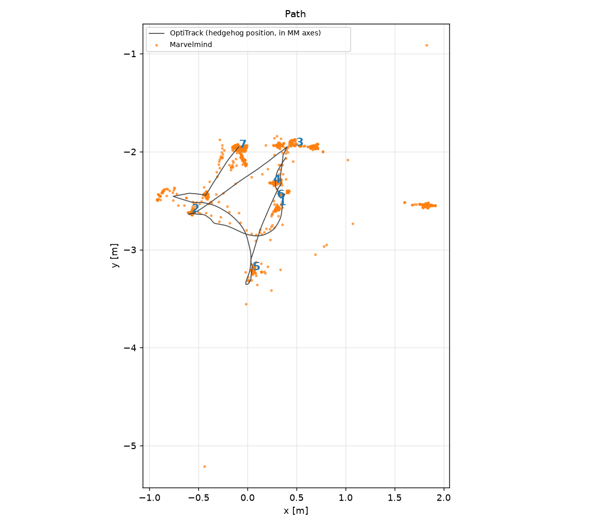
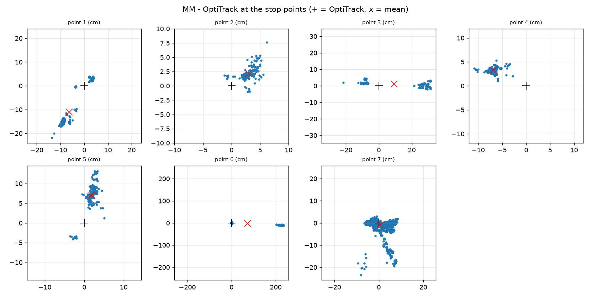
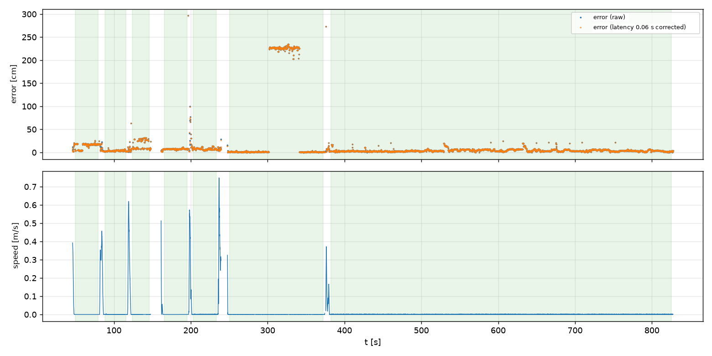

# Marvelmind test report

6 November 2026. The Marvelmind Super-Beacon-4 system (4 stationary beacons, hedgehog #7) was
compared with an OptiTrack V120:Trio.

## Setup

- Beacons at 1.33, 1.40, 1.47 and 1.52 m. The heights were measured and match the values in the
  Dashboard.
- OptiTrack markers were mounted on the hedgehog (rigid body). The hedgehog was carried by hand and
  placed on a stand at each point.
- The axes of the two systems were aligned in 2D using the mean positions at the stop points.

## Recordings

| Recording | Duration | Stops | Note |
|---|---|---|---|
| 1 | 143 s | 5 points, 5–30 s | The Trio cable came loose and the camera tilted by 48°; the tilt was corrected from the data afterwards. Least reliable recording. |
| 2 | 220 s | 4 points, ~30 s | Ground plane set again. The hedgehog was rotated by 90° at one point. |
| 3 | 828 s | 7 points, 22–443 s | At point 6 someone walked in front of a beacon. |

## Results

| | Recording 1 | Recording 2 | Recording 3 |
|---|---|---|---|
| Update rate | 5.65 Hz | 5.66 Hz | 5.72 Hz |
| Valid packets | 97.7 % | 97.9 % | 99.0 % |
| Longest gap | 0.54 s | 0.52 s | 0.69 s |
| Alignment RMS | 9.8 cm | 8.1 cm | 6.8 cm |
| Offset at the stop points, mean / worst | 6.9 / 10.1 cm | 7.0 / 10.2 cm | 6.4 / 17.7 cm |
| Jitter (std), mean / worst | 5.1 / 10.5 cm | 1.8 / 4.0 cm | 5.8 / 24.2 cm |
| Point-to-point distance error, RMS | 6.6 cm | 10.7 cm | 9.8 cm |
| Scale (MM / OptiTrack) | 0.973 | 1.093 | 0.933 |
| Latency | 0.07 s | 0.08 s | 0.06 s |
| Error while moving, RMS / p95 | 32.6 / 55.8 cm | 25.3 / 64.3 cm | 20.2 / 40.2 cm |

Offset: difference between the Marvelmind median at a point and the OptiTrack position. Samples more
than 20 cm from the median (jumps) were left out; in recording 3 these are 6.6 % of the samples.

Recording 3, stop points:

| Point | Duration (s) | Offset (cm) | Jitter std (cm) | Jumps (> 20 cm) |
|---|---|---|---|---|
| 1 | 29.6 | 17.7 | 4.2 | 34 |
| 2 | 27.7 | 3.3 | 1.8 | 0 |
| 3 | 21.8 | 6.7 | 24.2 | 0 |
| 4 | 29.7 | 7.6 | 1.2 | 0 |
| 5 | 30.2 | 7.5 | 3.5 | 0 |
| 6 | 122.0 | 0.8 | 0.9 | 224 |
| 7 | 443.2 | 1.1 | 5.1 | 7 |

## Observations

1. The update rate is stable at about 5.7 Hz. No recording has a gap longer than 2 s, so the 2 s
   timeout of `mm_monitor` would not report `MM_LOST` without reason in this setup.
2. At rest the offset is 1–10 cm at most points and 15–19 cm at a few.
3. There is no systematic scale error: one recording came out 9 % long, another 7 % short. The beacon
   heights and the Marvelmind map look correct; the difference comes from random scatter.
4. Recording 3, point 6 (300–345 s): while the hedgehog stood still, someone walked in front of a
   beacon. Marvelmind reported a steady position 2.3 m away for about 40 s, then returned to the
   correct one by itself. This position has no jitter, so a median filter cannot remove it. At point 3
   the position also switched between two places 34 cm apart.
5. The latency is small, 0.06–0.10 s, which is about 2 cm at 0.25 m/s. The 20–33 cm error while moving
   does not come from the latency: correcting the latency does not change it (32.6 → 32.5 cm).
